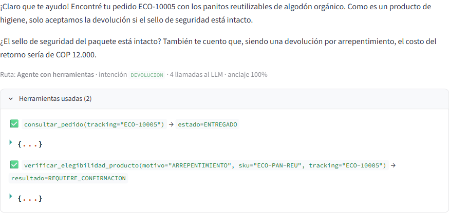
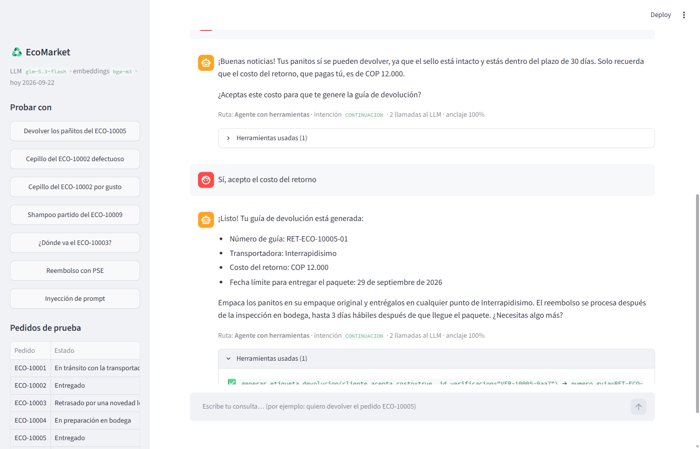
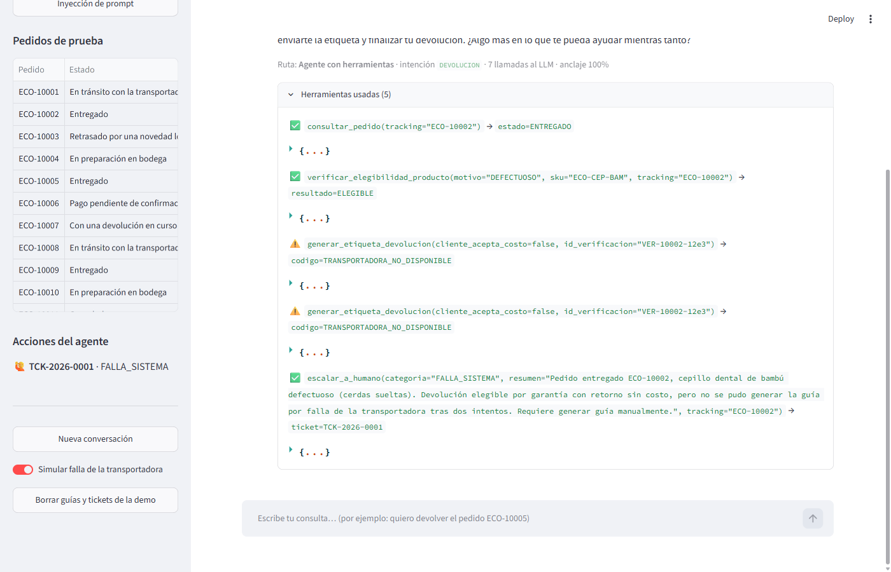
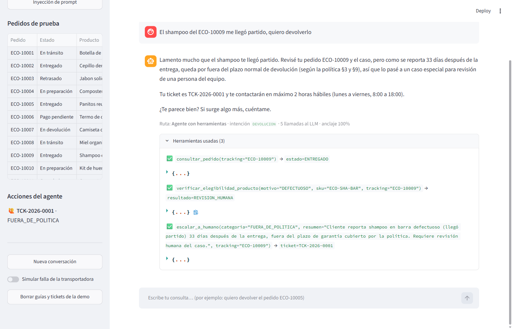

# Fase 4 — Despliegue de la Aplicación

**Caso:** EcoMarket — Agente de devoluciones para la atención al cliente
**Proyecto Final — IA Generativa — Maestría en Inteligencia Artificial, ICESI**

---

## 0. La decisión en una tabla

| Decisión | Elección | Razón principal |
|---|---|---|
| **Herramienta de interfaz** | **Streamlit** | La demo necesita mostrar, junto a cada respuesta, qué herramientas llamó el agente y qué devolvieron. Streamlit lo hace con piezas nativas |
| Dónde corre | Local: `streamlit run app.py` | El índice usa `bge-m3` en el Ollama local (ver sección 6 para publicarla) |
| Lógica en la interfaz | Ninguna | `app.py` llama a `AsistenteEcoMarket.responder()`, el mismo punto de entrada del chat de consola y de la evaluación |

---

## 1. Streamlit frente a Gradio

| Criterio | Streamlit | Gradio |
|---|---|---|
| Chat básico | `st.chat_message` + `st.chat_input`: unas 15 líneas | `gr.ChatInterface`: 3 líneas, más rápido |
| Mostrar la traza de herramientas bajo cada respuesta | `st.expander` y `st.json` dentro de cada mensaje | Mensajes con `metadata` en `gr.Chatbot`, que se muestran plegables |
| Panel lateral con ejemplos, pedidos y acciones | `st.sidebar` nativo | `gr.Blocks` con columnas |
| Estado por usuario (historial, id de la conversación) | `st.session_state` | `gr.State` |
| Recursos caros compartidos (índice, cliente LLM) | `@st.cache_resource` | Variables globales del módulo |
| Publicar gratis | Streamlit Community Cloud, desde el repo de GitHub | Hugging Face Spaces |
| Modelo de ejecución | Reejecuta el script completo en cada interacción | Funciones que responden a eventos |

**Por qué Streamlit.** Si la interfaz fuera solo un chat, Gradio ganaría por
simplicidad, y también puede mostrar los pasos intermedios del agente. La
diferencia está en el resto de la pantalla: la demostración necesita que se vea
**cómo** decide el agente y **qué efecto** tuvo cada acción. Eso es, además del
chat, un panel con los pedidos de prueba, las guías y los tickets creados, y
controles para simular fallas. En Streamlit todo eso son componentes estándar
(`st.sidebar`, `st.expander`, `st.json`, `st.toggle`) en un solo script que se
lee de arriba abajo, sin definir eventos ni callbacks.

**El costo de Streamlit** es que reejecuta todo el script en cada interacción.
Se resuelve con `@st.cache_resource`, que crea el asistente (y abre el índice
de Chroma) una sola vez por proceso, y con `st.session_state`, que guarda el
historial y el identificador de la conversación de cada pestaña.

---

## 2. Cómo ejecutarla

```bash
cd ProyectoFinal-EcoMarket
pip install -r requirements.txt
ollama pull bge-m3
set PYTHONIOENCODING=utf-8        # Windows
python -m scripts.indexar         # solo la primera vez
streamlit run app.py              # abre http://localhost:8501
```

Requiere `OLLAMA_API_KEY` en un `.env` de la carpeta del proyecto o de una
carpeta superior.

---

## 3. La interfaz



**Área principal.**
- **Aviso visible** de que se está hablando con un asistente de IA y de que se
  puede pedir una persona en cualquier momento (riesgo de opacidad, Fase 3).
- **Campo de texto** para el mensaje del cliente (`st.chat_input`) y el
  historial de la conversación.
- **Debajo de cada respuesta:** la ruta que siguió el mensaje (agente,
  respuesta informativa, respaldo o persona), la intención, las llamadas al LLM
  y la cobertura de anclaje.
- **"Herramientas usadas (n)":** cada llamada con sus argumentos, el dato clave
  del resultado y una marca ✅ o ⚠️ si la herramienta devolvió un error. El
  resultado completo se despliega como JSON.

**Barra lateral.**
- **Probar con:** siete ejemplos que llenan el mensaje con un clic: devolución
  con costo, garantía, negativa, revisión humana, estado de pedido, pregunta
  informativa e inyección de prompt.
- **Pedidos de prueba:** los 12 pedidos ficticios con su estado y producto.
- **Acciones del agente:** las guías y los tickets que el agente ha creado. Así
  se ve el efecto real de cada acción, no solo lo que dice el texto.
- **Controles de la demo:** nueva conversación, simular la caída de la
  transportadora y borrar las guías y tickets de la demo.

---

## 4. Demostración funcional de extremo a extremo

La aplicación se probó en un navegador controlado con Playwright, con
`glm-5.3-flash` en Ollama Cloud y el índice `bge-m3` real. Las tres pruebas
cubren el éxito, la decisión de no actuar y el manejo de errores.

### 4.1 Devolución con costo en tres turnos (ECO-10005)

1. «Quiero devolver los pañitos del ECO-10005, ya no los necesito» → el agente
   consulta el pedido, verifica y pregunta por el sello informando el costo
   (captura de la sección 3).
2. «Sí, el sello está intacto» → vuelve a verificar: ELEGIBLE con costo. Pide
   la aceptación.
3. «Sí, acepto el costo del retorno» → genera la guía `RET-ECO-10005-01`, que
   aparece en la respuesta y en "Acciones del agente".



### 4.2 Caída de la transportadora (manejo de errores)

Con "Simular falla de la transportadora" activado: «El cepillo del ECO-10002
llegó con las cerdas sueltas, quiero devolverlo». El motor aplica la garantía
(ELEGIBLE, sin costo); el agente intenta generar la guía, recibe
`TRANSPORTADORA_NO_DISPONIBLE` (⚠️), reintenta una vez, y al segundo fallo abre
el ticket `TCK-2026-0001` con categoría `FALLA_SISTEMA`. No se creó ninguna
guía.



### 4.3 Caso fuera de política (ECO-10009)

«El shampoo del ECO-10009 me llegó partido, quiero devolverlo». Han pasado 33
días desde la entrega y el producto no tiene garantía de 12 meses: el motor
devuelve `REVISION_HUMANA`, y el agente escala sin negar ni aprobar.



Además de estas pruebas en el navegador, los 12 casos de
`scripts/evaluar_agente.py` ejercitan el mismo `responder()` que usa la
interfaz (Fase 2, sección 7).

---

## 5. Detalles de implementación que importan

- **Los `$` se escapan.** Streamlit interpreta `$...$` como LaTeX, y una
  respuesta con «COP $12.000» o «Costo: $0» se veía rota. `texto_seguro()` los
  escapa antes de mostrar cada mensaje.
- **La barra lateral se refresca después de una acción.** Streamlit dibuja la
  barra antes de que el agente responda; si el turno generó una guía o un
  ticket, la app reejecuta el script (`st.rerun()`) para que la acción aparezca.
- **Una conversación por pestaña.** El `hilo` vive en `st.session_state`; "Nueva
  conversación" crea otro. El agente recuerda los turnos por ese `hilo`.
- **El interruptor de falla es global.** Cambia la variable de entorno del
  proceso, así que afecta a todas las pestañas abiertas. Es aceptable para una
  demo local; en un despliegue compartido debería ser una opción por sesión.
- **Las guías se guardan** en `data/devoluciones.json` (no se versiona). "Borrar
  guías y tickets de la demo" lo vacía para repetir la demostración: si no, el
  agente respondería que la guía ya existe.

### Un problema de dependencias

Al instalar con `pip install -r requirements.txt` se instala protobuf 7, que ya
no incluye `google.protobuf.json_format`, y Streamlit 1.66 falla al importar
(aunque declara compatibilidad hasta la versión 8). `requirements.txt` fija
`protobuf>=5.26,<7`.

---

## 6. Publicarla en internet (opcional)

Streamlit Community Cloud despliega gratis desde el repositorio de GitHub. Antes
de hacerlo hay que resolver tres cosas:

1. **Los embeddings.** `bge-m3` corre en el Ollama local, que no existe en la
   nube. Opciones: `ECOMARKET_EMBEDDINGS=openai-3-small` (requiere una key de
   OpenAI y recalibrar el umbral) o publicar el índice junto con un servicio de
   embeddings propio.
2. **Las keys.** Van en los *secrets* de Streamlit, nunca en el repositorio.
3. **La autenticación.** Una URL pública sin autenticación permitiría a
   cualquiera generar guías con números de seguimiento ajenos (Fase 3, riesgo
   de suplantación). Con datos ficticios es aceptable para una demo; con datos
   reales, no.

El prototipo de este proyecto corre localmente.
